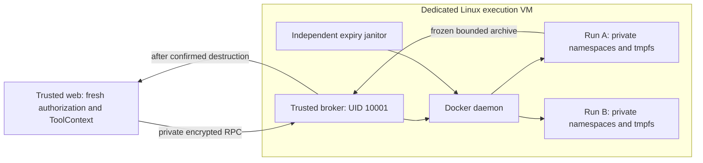

# Per-execution isolation

**Acceptance is in progress.** Additional recovery and platform isolation checks are underway. Keep `SANDBOX_SERVICE_URL` and `SANDBOX_SECRET` unset for unattended use until the reopened SEC-04 criteria pass. The local demo currently disables these application Python/shell calls; provider-native code tools have their own settings. Prior Linux test results below describe the checks performed, not completion of the new review.

SEC-04 replaces shared subprocess execution with a narrow broker that creates a
new Linux container for each Python or shell call. It is a code-execution slice of
the Pal runtime. Persistent browser sessions, interactive terminal takeover,
personal-computer pairing and network-enabled execution need separate policies and
are not provided by this backend.

## Decision and trust boundary

Run the broker on a **dedicated Linux execution VM/host**. Keep the web application,
database, uploaded files, configuration encryption key and provider credentials
outside that VM. The application sends a bounded source string and trusted user
identity to the broker over a private encrypted connection. Only the broker and
its independent janitor may access the execution VM's Docker socket. Never mount
that socket into the web application or a workload.



The broker is trusted infrastructure: Docker socket permission is administrative
authority over its host. The generated program is not trusted. It runs as UID/GID
65532 with empty supplementary groups, zero inheritable/permitted/effective/
bounding/ambient capabilities and no-new-privileges. It shares neither the broker
UID nor its PID namespace, secrets or writable files. Each run has private PID,
IPC, cgroup and network namespaces and its own writable tmpfs. No application or
other-run directory is mounted into it.

A small, secret-free, root-owned supervisor stays inside the workload container.
Its launcher drops authority before executing submitted source. The supervisor's
root-only control directory holds the completion record, while the code can write
only its isolated working areas. The image contains Python's standard library and
a POSIX shell; uploaded files and optional plotting packages are not provisioned.

Source arrives as raw UTF-8 bytes in a bounded tar upload into the running
container's private RAM-backed control volume. Three fixed regular-file entries
carry the source, server-generated language/timeout/length/hash metadata, and a
final empty completion marker. The supervisor waits for that marker, validates
sizes and integrity, removes source/request metadata, then launches the child with
a clean environment. The empty marker remains until teardown so Docker can finish
applying its file metadata. Docker environment/configuration and image layers contain no
source. Trusted execution-host administrators can still inspect live VM memory or
storage; host swap/snapshots remain an operator retention concern. Never log source
or put unrelated credentials in it. The child cannot read the supervisor's
environment or root-only control directory.

This is a **container boundary within a VM**, not a VM per call. Ordinary `runc`
containers share the VM kernel. A container or kernel escape can compromise the
execution VM, including its broker, so the VM must carry no application data or
provider credentials. Docker's security documentation describes daemon authority
and the limitations of namespace/capability isolation. A cloud tenant release still
needs a separately reviewed stronger runtime/VM policy; selecting `runsc` alone is
not evidence that its complete policy has been validated. [Docker security](https://docs.docker.com/engine/security/)

## Enforced request and runtime policy

`POST /execute` requires the broker secret before its body is read. JSON is limited
to 768,000 bytes and source to 100,000 UTF-8 bytes. The required `principal_id` comes
from the web's `ToolContext`, never model arguments. The broker trusts the web to
authorize that identity. It hashes the principal for resource labels and generates
the execution UUID itself. No caller-visible resource handle can be reused to join
another call. Extra JSON properties are rejected.

The broker builds the complete runtime specification. Request data cannot select
images, commands for the supervisor, environment variables, daemon flags, mounts,
devices, networking, resource budgets or host paths. Only an operator-configured,
preloaded immutable image digest/ID is accepted; the broker never pulls images.
Images declaring implicit volumes are rejected. The image build currently resolves its
Python base tag when built: record and approve the resulting immutable image ID,
and review rebuilds before replacing it.

| Resource | Enforced policy |
| --- | --- |
| Admission | Two active/pending/orphan runs per broker by default; one per principal. Excess calls receive 429 without queuing. Operator can set at most eight total. |
| Compute | One CPU, 512 MiB memory, no additional swap, 64 PIDs per run. |
| Runtime | Caller timeout 1–45 seconds; independent absolute expiry 90 seconds after creation. |
| Filesystem | Read-only image; no host binds/devices. Fresh private local volumes backed by tmpfs: workspace 64 MiB/1,024 inodes and root-only control 1 MiB/32 inodes. Native temporary tmpfs 8 MiB/256 inodes. |
| Process limits | CPU time, 512 MiB address space per process, 1 MiB single-file writes, 64 descriptors, zero core size. PID cgroups avoid cross-run `RLIMIT_NPROC` coupling through equal host UIDs. |
| Network | Docker `none` network, no published ports; only isolated loopback. No policy to enable egress exists in the request. |
| Output | 64 KiB stdout, 8 KiB stderr; overflow terminates execution and withholds artifacts. |
| Artifacts | At most ten top-level regular files, 1 MiB each and 4 MiB total; 8 MiB archive/read budget, 1,000 entries, bounded names/PAX metadata. |

Startup and readiness require Linux, cgroup v2, working memory/swap/PID/CPU
accounting, default built-in seccomp and the configured runtime. The service does
not silently remove unsupported limits. Docker resource settings and its default
seccomp profile remain part of the deployment contract.
[Resource controls](https://docs.docker.com/engine/containers/resource_constraints/),
[default seccomp](https://docs.docker.com/engine/security/seccomp/)

## Completion, cancellation and artifacts

Real Docker testing exposed two archive API restrictions with native tmpfs:
uploads were rejected with a read-only root filesystem, and contents were absent
from the archive read endpoint. The broker instead creates two fresh UUID-named
Docker local volumes with fixed `type=tmpfs`,
`device=tmpfs` and bounded mount options. They are attached only to that run, with
`NoCopy=true`. Exact labels, driver and options are validated before execution.
Validation repeats after container creation, before start: a paused broker cannot
resume after orphan expiry and accept Docker's automatic default-volume recreation.
There are no caller-provided volume names/options, host paths or broker mounts.
Uploads into the running control volume and paused artifact reads were verified
on the dedicated Linux VM while preserving the read-only root filesystem.
[Docker copy limitations](https://docs.docker.com/reference/cli/docker/container/cp/)

The broker pauses the **whole container** and verifies that state before reading
the workspace. A descendant that called `setsid` is still inside that container's
PID/cgroup boundary. The tar stream is read directly through bounded readers;
nothing is extracted to the broker filesystem. Traversal, duplicate paths, links,
sparse entries, devices, FIFOs and unexpected nested file exports fail closed.
An invalid artifact discards the entire file batch. Successful regular files carry
SHA-256 integrity values and are persisted by the web under the authenticated
user's ownership.

Normal completion, timeout, cancellation, HTTP disconnect, startup failure and
export failure all go through whole-container removal followed by both private
volume removals. The broker confirms all three are gone before returning output
files. If the daemon is unavailable or destruction cannot
be confirmed, the caller receives an error with no artifacts. An uncertain create
is reconciled by broker/run labels rather than assuming no container was created.
An uncertain create or failed destruction also quarantines broker admission and
readiness. Reconcile the daemon's resources before restarting that broker; this
prevents new requests from over-admitting while an earlier create may complete late.

The independent janitor runs every five seconds. It only removes resources with
the expected managed marker, broker identity, valid run/owner labels and expired
lifetime. It clamps an expiry label to creation time plus 90 seconds, so a label
cannot extend the lifetime indefinitely. Startup also reconciles expired resources.
Admission and reconciliation count volume-only runs too, including a crash between
the first volume creation and container creation. Cleanup always removes containers
before storage and refuses unexpected names, labels, drivers or mount options.
If the daemon itself is unreachable, neither process can promise immediate
destruction: restoration of daemon access or operator intervention is required.
The VM boundary and per-container limits remain the containment mechanism during
that uncertainty.

There is no shared-process fallback. Application Compose contains neither a broker
service nor the former shared sandbox network. Both web clients require an explicit
external broker URL and matching secret; absent or invalid settings fail before
network access. Redirects are rejected so the broker secret cannot be forwarded.
The trusted `ToolContext` carries the caller's abort signal, composed with each
execution deadline. A cancelled, malformed or unconfirmed outcome stops the current
chat tool loop instead of allowing model-directed execution retry. Closing the HTTP
connection is a cancellation request, not proof that a remote workload stopped:
the broker's cleanup confirmation and janitor remain authoritative. Completed
side effects are not rolled back. Durable run records, restart recovery of tool
outcomes and exactly-once side effects remain separate RUN work.

## Deployment contract

Use `deploy/execution/compose.yml` only on the dedicated execution VM. Do not merge
it into application Compose. Maintain **one broker container and one Uvicorn worker
per Docker daemon**; do not scale replicas or workers. Admission reservations are
process-local, and multiple broker instances could race the shared inventory.
The independent janitor is separate and may continue after the broker stops.

1. Provision a disposable/rebuildable Linux VM with Docker Engine API v1.45 support,
   cgroup v2 and the required resource/seccomp controls. Keep the host patched.
2. Build `services/sandbox/Dockerfile.workload`, inspect its immutable image ID,
   review the source/image and preload that image on the execution VM. Build the
   broker separately from `services/sandbox/Dockerfile`.
3. Copy `deploy/execution/.env.example` to a private mode-0600 operator file. Set
   the socket's group ID, stable unique broker ID, approved immutable workload image,
   private bind IP and a new random broker secret. Do not copy the application `.env`
   or mount configuration/uploads. Only the broker receives the broker secret.
4. Restrict the broker port to the trusted web host through an encrypted private
   tunnel/VPN, or terminate authenticated TLS before it. The supplied Compose file
   binds a private interface but does **not** implement transport encryption. Never
   expose its plain HTTP listener publicly or assume an ordinary LAN encrypts it.
5. Start the execution Compose stack and verify `/ready` through the approved
   private route. Set the web's `SANDBOX_SERVICE_URL` to the broker base URL (without
   `/execute`) and `SANDBOX_SECRET` to the matching broker-only secret, then restart
   only the web service. Both are blank by default; leaving either unset disables
   execution while ordinary chat/readiness continues to work. Preserve existing
   application environment files and data. Never give the web a daemon socket,
   Docker credentials or the execution VM's administrative credentials.
   A host-run web process can use a loopback SSH tunnel. Inside a web container,
   `127.0.0.1` refers to that container, so provide a private encrypted endpoint
   reachable from its network namespace; do not expose the broker publicly to
   work around connectivity. URLs with credentials, query strings or fragments
   are rejected; use the explicit secret setting.
6. Run the disposable acceptance suite on the exact chosen runtime/kernel/image
   before enabling execution. Alert on repeated 503s, failed janitor operations,
   unexpected resource inventory and exhausted capacity.

A future local Mac adapter should provision a dedicated Linux VM and send only
this RPC across the private boundary. It must not execute source in macOS, mount
the user's home directory or fall back to a host shell when the VM is unavailable.
No VM installer or purchasing flow is included in this change.

## Acceptance evidence and release boundary

| Check | Evidence |
| --- | --- |
| Authentication/body bounds, fixed policy, immutable images, no fallback | Host-safe API/policy tests; no submitted source runs on the test host. |
| Duplicate/traversal/sparse/PAX/link archives, byte/file/entry limits | Synthetic archive regressions; no extraction. |
| Maximum UTF-8 source, partial uploads, marker/integrity checks, no source in container metadata | Host-safe bootstrap regressions plus real Linux metadata/control probes. |
| Cancellation during volume/container create, start/upload/export; uncertain create/removal | Mocked lifecycle regressions verify resource removal, quarantine and withheld artifacts. |
| Fresh UID/caps/groups, other-run file/PID absence, no secret/socket/network | Real Linux HTTP probes in `test_linux_container.py`. |
| Artifact hash/ownership boundary, fresh workspaces, shell support | Real Linux file round-trip; web client tests prove trusted principal selection and reject unconfirmed cleanup. Database ownership stays covered by existing file authorization tests. |
| Kernel memory/PID/file/inode limits and output bounds | Real Linux resource probes inside disposable workloads. |
| Timeout/disconnect with a `setsid` descendant | Real Linux lifecycle test requires the complete labeled container to disappear. |
| Broker crash | Real independent janitor test covers a volume-only orphan and all three resources of a running execution, waiting for the 90-second expiry without a live broker. |

The application CI job verifies that ordinary startup needs no broker settings and
that application Compose exposes no shared execution service/network or Docker
socket. The separate sandbox CI job runs the host-safe suite and the real Linux
harness below, including independent janitor expiry. It has no application database,
provider credentials or stable execution deployment.

Run host-safe checks with `python -m unittest discover -s services/sandbox/tests -v`.
Run real checks only on an explicitly disposable Linux Docker runner:

```sh
POLARIS_DISPOSABLE_EXECUTION_CI=1 bash services/sandbox/tests/run-isolated-linux.sh
```

The harness builds both images, uses only synthetic inputs and a generated broker
secret, and cleans only its own UUID-named/labeled fixtures. It does not touch
production databases, uploaded files or API credentials. Local mocked tests passing
on macOS do not certify Linux isolation; attach the successful Linux job before
calling the backend verified. Passing `runc` checks also does not certify a `runsc`
deployment, a microVM boundary, browser egress or unattended cloud tenancy.
